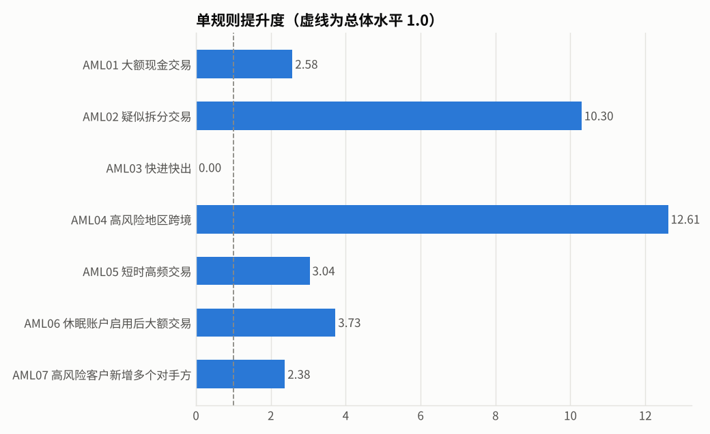
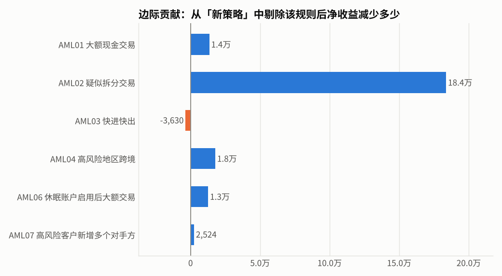
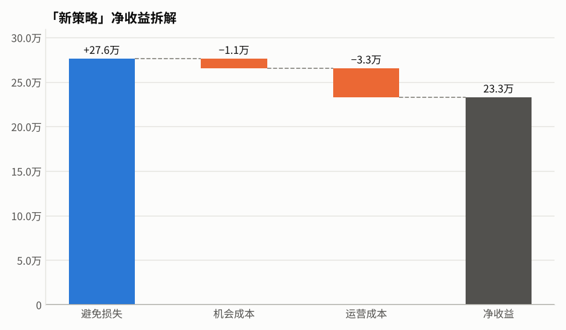
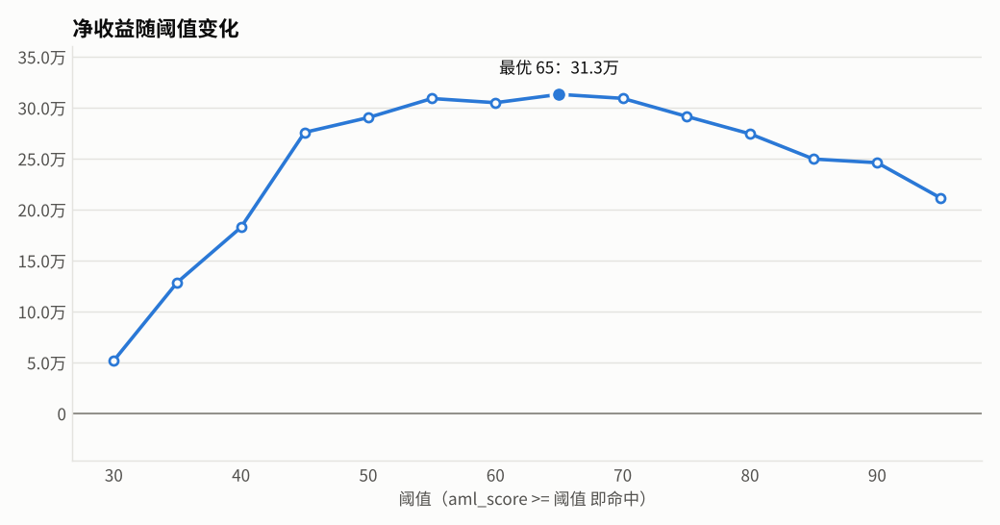
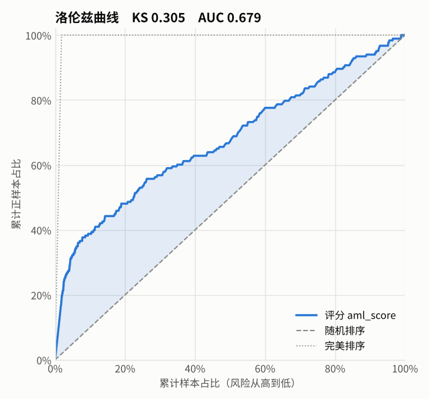
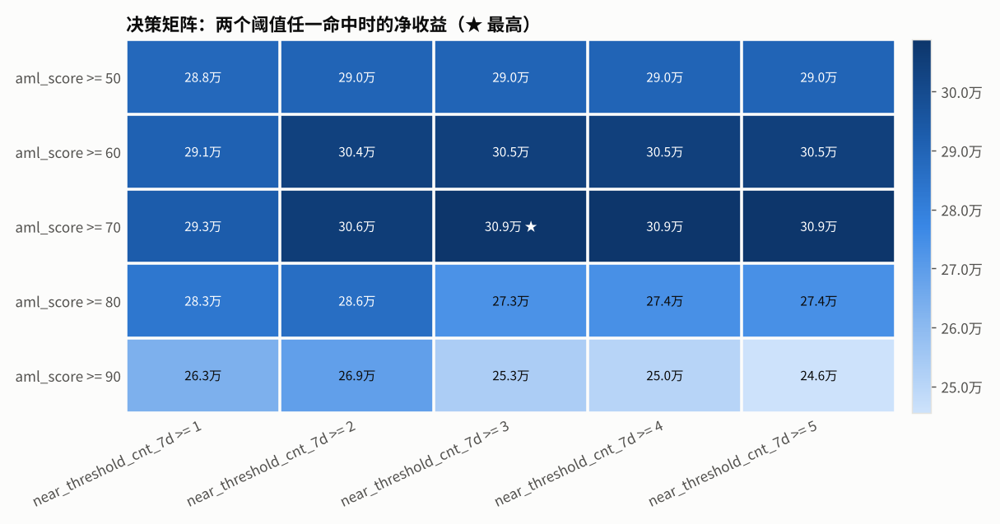

# 反洗钱：规则策略评估摘要

净收益 = 避免损失 − 机会成本 − 运营成本

## 结论

1. 样本 10,000 条，正样本 183 个，正样本率 1.83%。
2. 提升度最高的规则是 AML04 高风险地区跨境：命中 13 条，精确率 23.1%，提升度 12.61。
3. 提升度低于 1（命中群体的正样本率低于总体）的规则：AML03，需要检查阈值或逻辑。
4. 单独看净收益为负的规则：AML03。
5. 新策略净收益 232,679 元，现行策略 231,557 元，新策略多 1,122 元；召回率 27.3% → 25.7%，精确率 9.3% → 11.5%，命中量 537 → 407。
6. 在新策略里，边际贡献最大的是 AML02 疑似拆分交易（183,776 元）。
7. 边际贡献为负的规则：AML03（-3,630），剔除后整体净收益反而更高，应收紧、合并或淘汰。
8. Swap 分析：新增命中的 77 条正样本率 9.1%，新增放行的 207 条正样本率 4.8%（总体 1.83%）。
9. 阈值扫描：aml_score >= 65 时净收益最高，为 312,702 元（命中 839 条，召回率 37.7%）。
10. aml_score 的 KS 为 0.305，AUC 为 0.679。
11. 敏感性分析：避免损失与机会成本浮动 30% 时，两套策略的优劣关系会翻转，结论依赖参数假设，需要先把参数估准。
12. 稳定性：aml_score 在 2026-06 相对 2026-01 的 PSI 为 0.0032（稳定）。

## 单规则

| 规则ID | 规则名称 | 命中量 | 召回率 | 精确率 | 提升度 | 净收益 |
|---|---|---|---|---|---|---|
| AML01 | 大额现金交易 | 106 | 2.7% | 4.7% | 2.58 | 19,646 |
| AML02 | 疑似拆分交易 | 191 | 19.7% | 18.8% | 10.30 | 190,010 |
| AML03 | 快进快出 | 34 | 0.0% | 0.0% | 0.00 | -3,740 |
| AML04 | 高风险地区跨境 | 13 | 1.6% | 23.1% | 12.61 | 17,796 |
| AML05 | 短时高频交易 | 216 | 6.6% | 5.6% | 3.04 | 41,435 |
| AML06 | 休眠账户启用后大额交易 | 44 | 1.6% | 6.8% | 3.73 | 12,457 |
| AML07 | 高风险客户新增多个对手方 | 23 | 0.5% | 4.3% | 2.38 | 2,524 |

## 策略对比

| 策略 | 命中量 | 召回率 | 精确率 | 避免损失 | 机会成本 | 运营成本 | 净收益 |
|---|---|---|---|---|---|---|---|
| 现行策略 | 537 | 27.3% | 9.3% | 289,127 | 14,610 | 42,960 | 231,557 |
| 新策略 | 407 | 25.7% | 11.5% | 276,039 | 10,800 | 32,560 | 232,679 |
| 差异（新策略 − 现行策略） | -130 | -1.6% | 2.2% | -13,088 | -3,810 | -10,400 | 1,122 |

## 图表

### 单规则提升度

### 边际贡献

### 净收益瀑布图

### 阈值扫描净收益曲线

### 洛伦兹曲线

### 决策矩阵热力图

