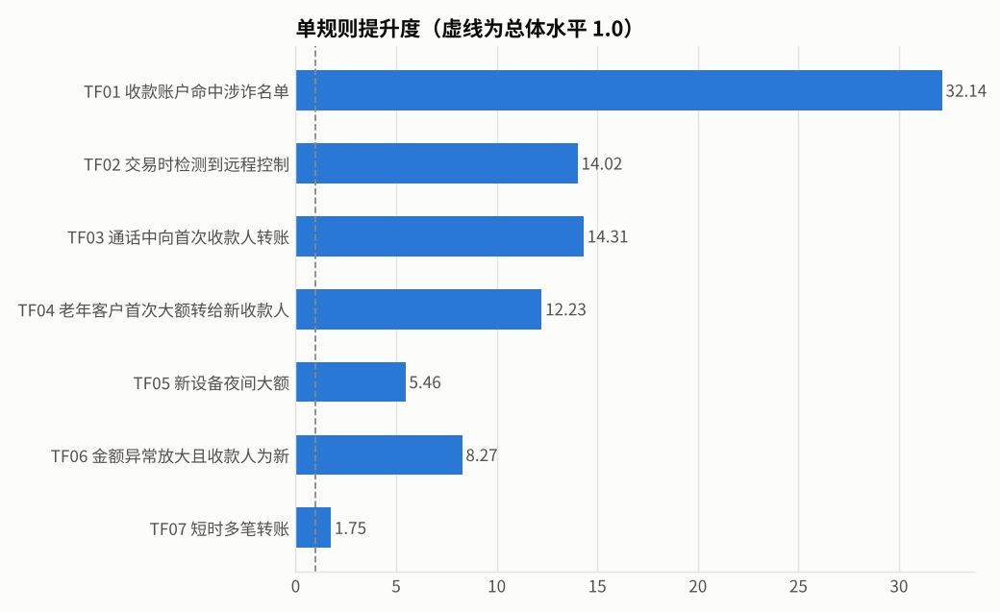
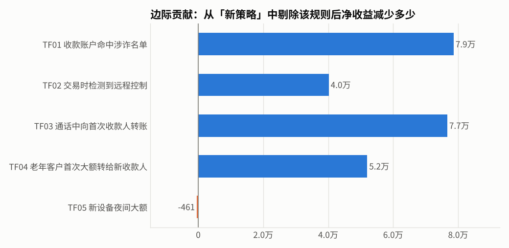
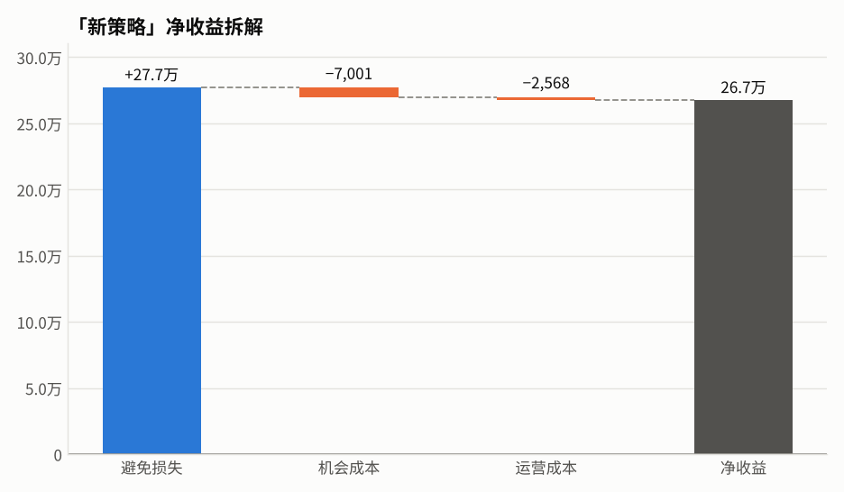
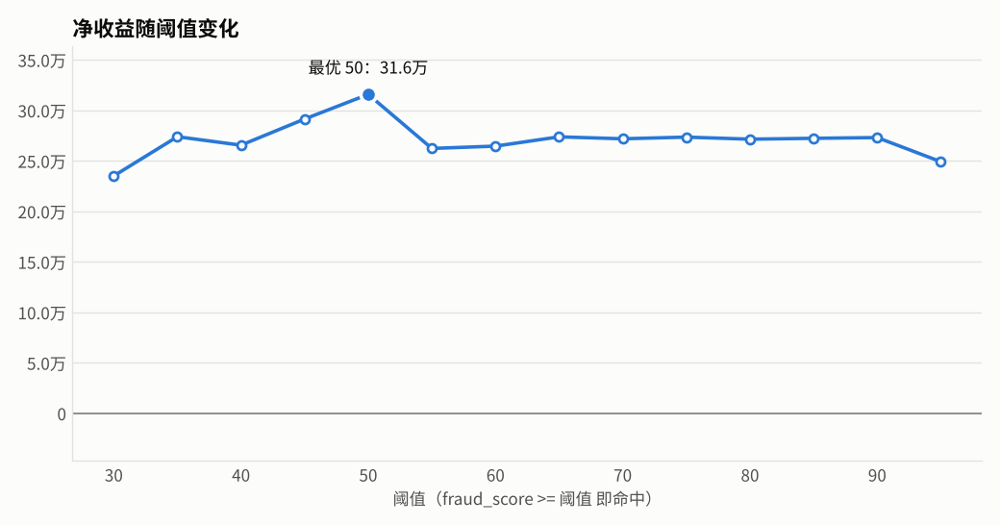
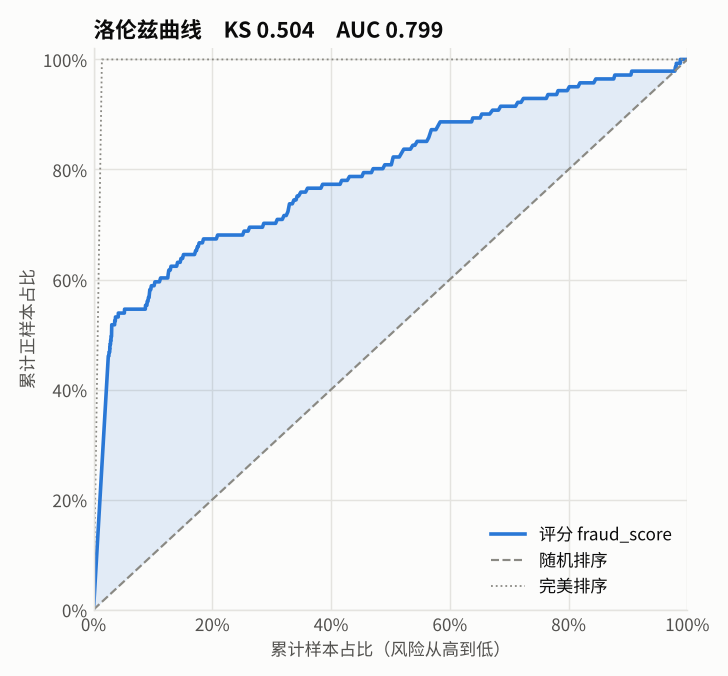
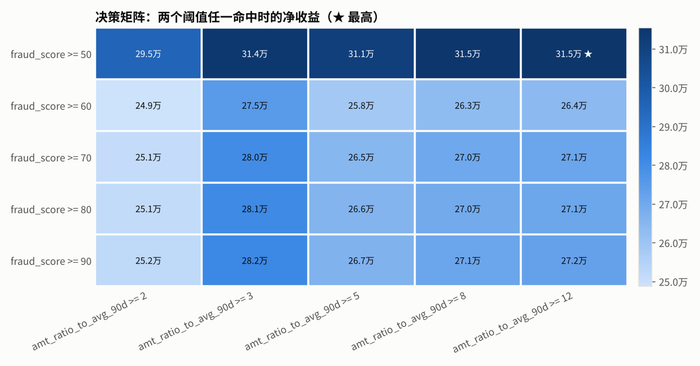

# 反电诈：规则策略评估摘要

净收益 = 避免损失 − 机会成本 − 运营成本

## 结论

1. 样本 10,000 条，正样本 141 个，正样本率 1.41%。
2. 提升度最高的规则是 TF01 收款账户命中涉诈名单：命中 64 条，精确率 45.3%，提升度 32.14。
3. 新策略净收益 267,454 元，现行策略 107,306 元，新策略多 160,148 元；召回率 31.2% → 50.4%，精确率 8.4% → 22.1%，命中量 524 → 321。
4. 在新策略里，边际贡献最大的是 TF01 收款账户命中涉诈名单（78,636 元）。
5. 边际贡献为负的规则：TF05（-461），剔除后整体净收益反而更高，应收紧、合并或淘汰。
6. Swap 分析：新增命中的 243 条正样本率 14.8%，新增放行的 446 条正样本率 2.0%（总体 1.41%）。
7. 阈值扫描：fraud_score >= 50 时净收益最高，为 315,596 元（命中 2090 条，召回率 68.1%）。
8. fraud_score 的 KS 为 0.504，AUC 为 0.799。
9. 敏感性分析：避免损失与机会成本各浮动 30%，两套策略的优劣关系不变。
10. 稳定性：fraud_score 在 2026-06 相对 2026-01 的 PSI 为 0.0029（稳定）。

## 单规则

| 规则ID | 规则名称 | 命中量 | 召回率 | 精确率 | 提升度 | 净收益 |
|---|---|---|---|---|---|---|
| TF01 | 收款账户命中涉诈名单 | 64 | 20.6% | 45.3% | 32.14 | 80,060 |
| TF02 | 交易时检测到远程控制 | 86 | 12.1% | 19.8% | 14.02 | 56,158 |
| TF03 | 通话中向首次收款人转账 | 109 | 15.6% | 20.2% | 14.31 | 84,840 |
| TF04 | 老年客户首次大额转给新收款人 | 58 | 7.1% | 17.2% | 12.23 | 57,432 |
| TF05 | 新设备夜间大额 | 13 | 0.7% | 7.7% | 5.46 | 9,991 |
| TF06 | 金额异常放大且收款人为新 | 60 | 5.0% | 11.7% | 8.27 | 17,553 |
| TF07 | 短时多笔转账 | 406 | 7.1% | 2.5% | 1.75 | 18,026 |

## 策略对比

| 策略 | 命中量 | 召回率 | 精确率 | 避免损失 | 机会成本 | 运营成本 | 净收益 |
|---|---|---|---|---|---|---|---|
| 现行策略 | 524 | 31.2% | 8.4% | 124,998 | 13,500 | 4,192 | 107,306 |
| 新策略 | 321 | 50.4% | 22.1% | 277,023 | 7,001 | 2,568 | 267,454 |
| 差异（新策略 − 现行策略） | -203 | 19.1% | 13.7% | 152,025 | -6,499 | -1,624 | 160,148 |

## 图表

### 单规则提升度

### 边际贡献

### 净收益瀑布图

### 阈值扫描净收益曲线

### 洛伦兹曲线

### 决策矩阵热力图

