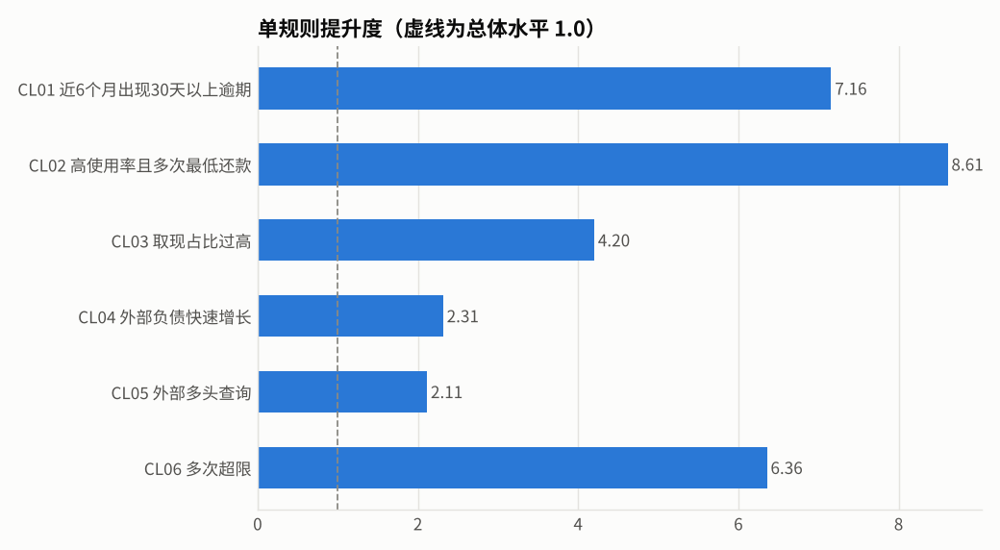
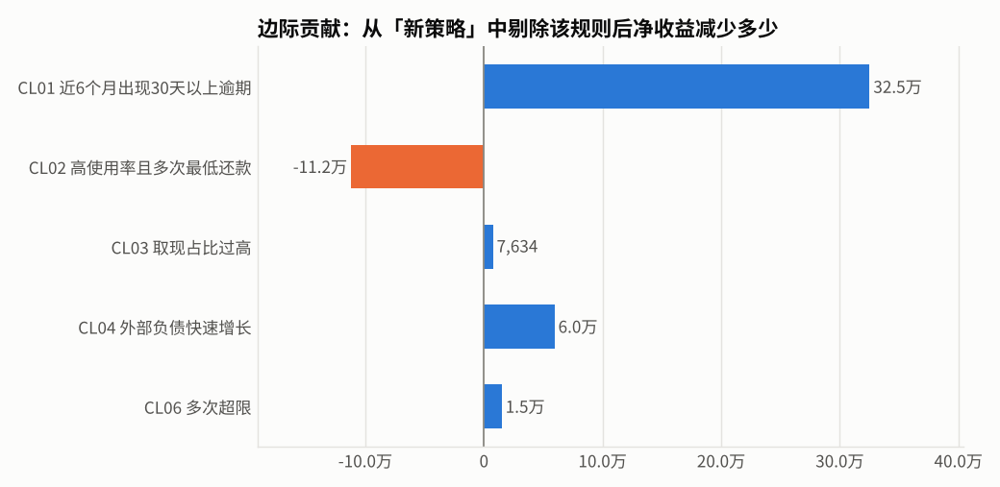
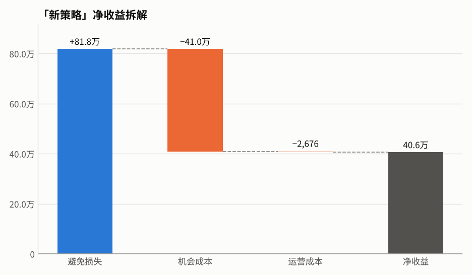
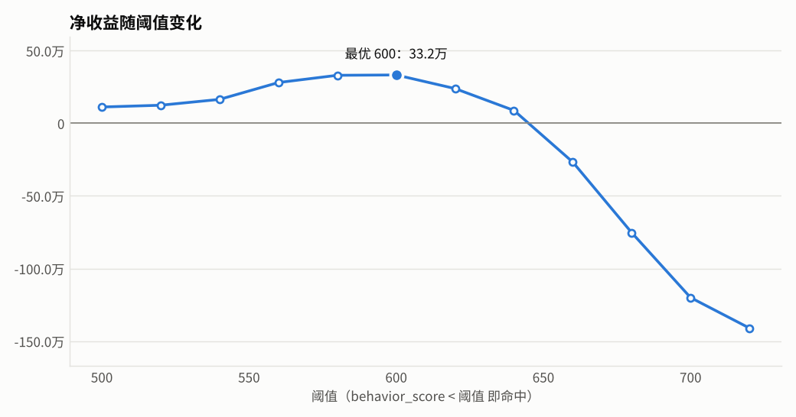
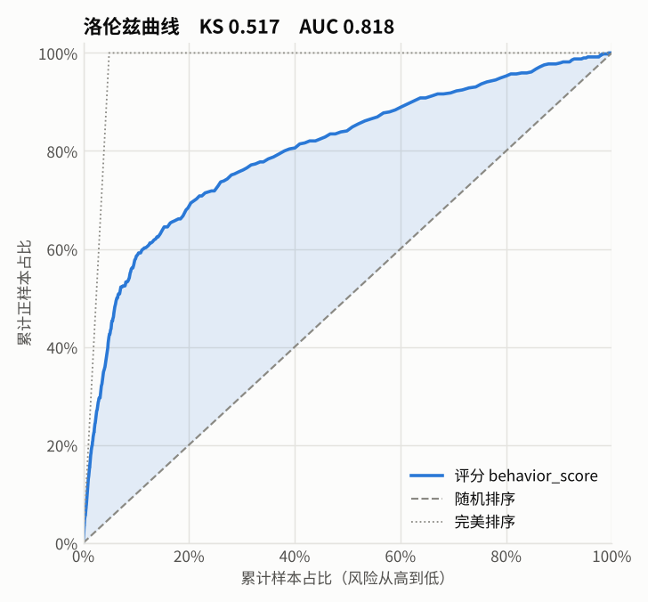
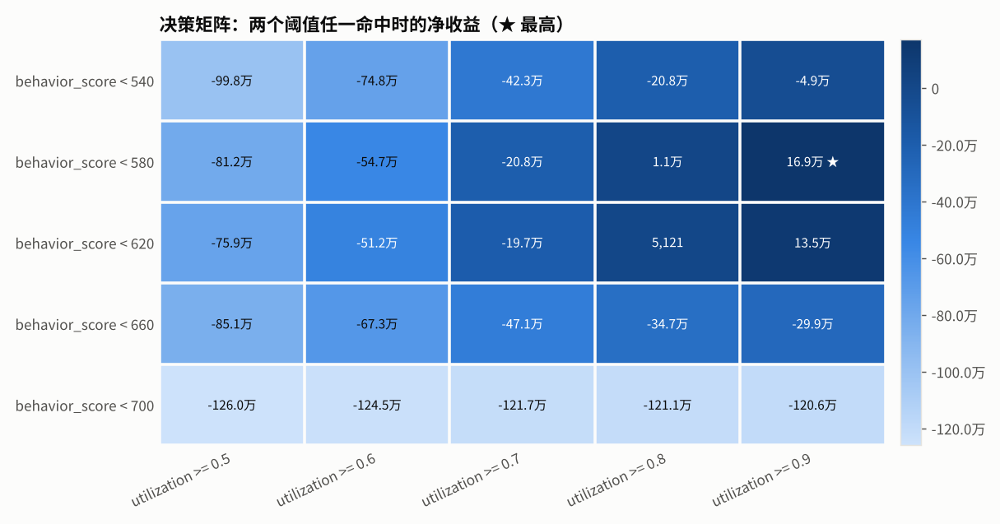

# 贷中调额：规则策略评估摘要

净收益 = 避免损失 − 机会成本 − 运营成本

## 结论

1. 样本 10,000 条，正样本 490 个，正样本率 4.90%。
2. 提升度最高的规则是 CL02 高使用率且多次最低还款：命中 327 条，精确率 42.2%，提升度 8.61。
3. 单独看净收益为负的规则：CL02。
4. 新策略净收益 405,585 元，现行策略 439,858 元，新策略少 34,274 元；召回率 26.5% → 61.8%，精确率 25.4% → 22.6%，命中量 511 → 1338。
5. 在新策略里，边际贡献最大的是 CL01 近6个月出现30天以上逾期（325,218 元）。
6. 边际贡献为负的规则：CL02（-112,110），剔除后整体净收益反而更高，应收紧、合并或淘汰。
7. Swap 分析：新增命中的 995 条正样本率 18.3%，新增放行的 168 条正样本率 5.4%（总体 4.90%）。
8. 阈值扫描：behavior_score < 600 时净收益最高，为 332,197 元（命中 989 条，召回率 58.0%）。
9. behavior_score 的 KS 为 0.517，AUC 为 0.818。
10. 敏感性分析：避免损失与机会成本浮动 30% 时，两套策略的优劣关系会翻转，结论依赖参数假设，需要先把参数估准。
11. 稳定性：utilization 在 2026-06 相对 2026-01 的 PSI 为 0.0019（稳定）。

## 单规则

| 规则ID | 规则名称 | 命中量 | 召回率 | 精确率 | 提升度 | 净收益 |
|---|---|---|---|---|---|---|
| CL01 | 近6个月出现30天以上逾期 | 325 | 23.3% | 35.1% | 7.16 | 438,733 |
| CL02 | 高使用率且多次最低还款 | 327 | 28.2% | 42.2% | 8.61 | -116,382 |
| CL03 | 取现占比过高 | 34 | 1.4% | 20.6% | 4.20 | 11,545 |
| CL04 | 外部负债快速增长 | 670 | 15.5% | 11.3% | 2.31 | 162,705 |
| CL05 | 外部多头查询 | 193 | 4.1% | 10.4% | 2.11 | 19,864 |
| CL06 | 多次超限 | 61 | 3.9% | 31.1% | 6.36 | 29,735 |

## 策略对比

| 策略 | 命中量 | 召回率 | 精确率 | 避免损失 | 机会成本 | 运营成本 | 净收益 |
|---|---|---|---|---|---|---|---|
| 现行策略 | 511 | 26.5% | 25.4% | 562,590 | 121,710 | 1,022 | 439,858 |
| 新策略 | 1,338 | 61.8% | 22.6% | 818,160 | 409,899 | 2,676 | 405,585 |
| 差异（新策略 − 现行策略） | 827 | 35.3% | -2.8% | 255,570 | 288,190 | 1,654 | -34,274 |

## 图表

### 单规则提升度

### 边际贡献

### 净收益瀑布图

### 阈值扫描净收益曲线

### 洛伦兹曲线

### 决策矩阵热力图

