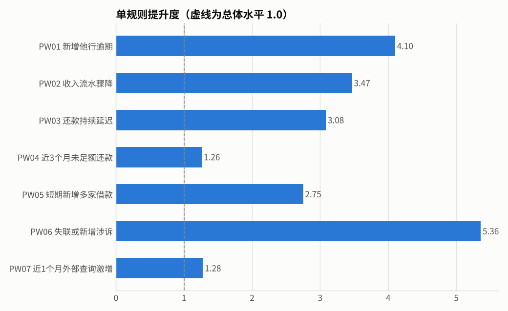
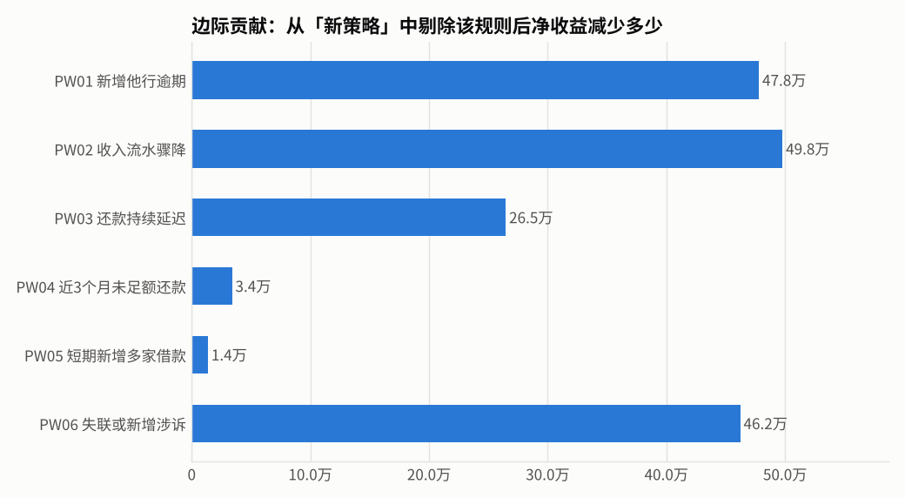
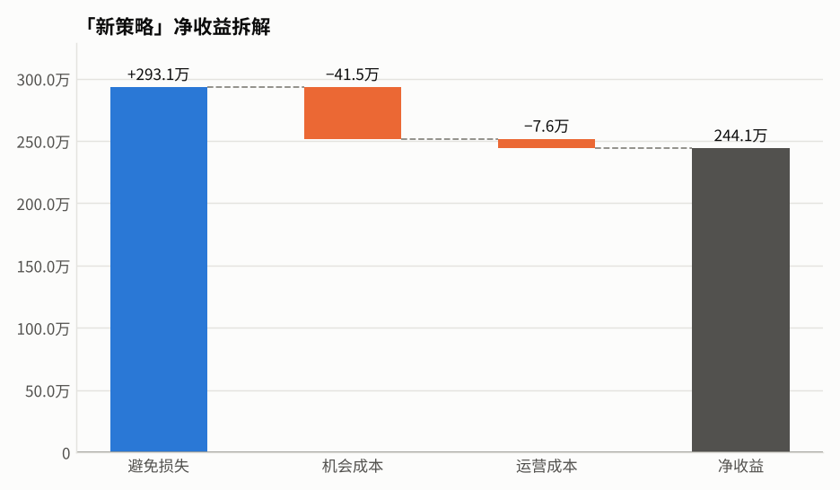
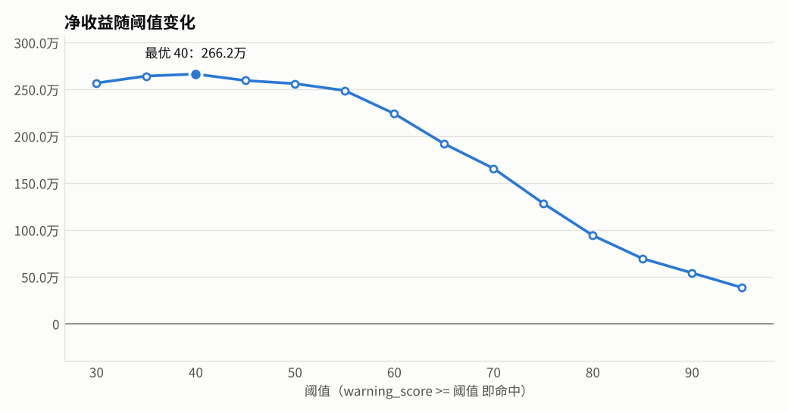
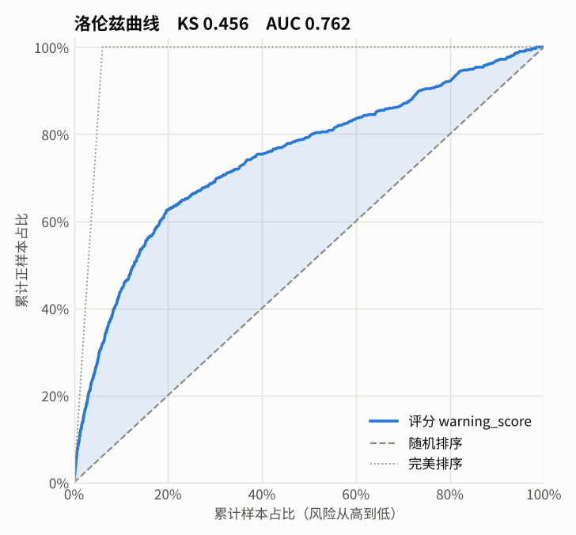
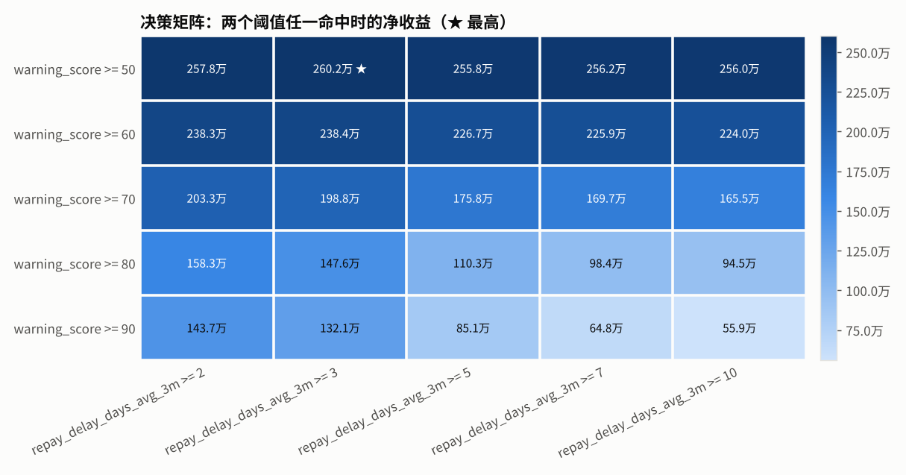

# 贷后预警：规则策略评估摘要

净收益 = 避免损失 − 机会成本 − 运营成本

## 结论

1. 样本 10,000 条，正样本 606 个，正样本率 6.06%。
2. 提升度最高的规则是 PW06 失联或新增涉诉：命中 311 条，精确率 32.5%，提升度 5.36。
3. 新策略净收益 2,440,677 元，现行策略 1,252,815 元，新策略多 1,187,862 元；召回率 33.7% → 64.5%，精确率 19.3% → 15.5%，命中量 1055 → 2522。
4. 在新策略里，边际贡献最大的是 PW02 收入流水骤降（497,874 元）。
5. Swap 分析：新增命中的 1589 条正样本率 12.1%，新增放行的 122 条正样本率 4.9%（总体 6.06%）。
6. 阈值扫描：warning_score >= 40 时净收益最高，为 2,662,406 元（命中 4526 条，召回率 77.7%）。
7. warning_score 的 KS 为 0.456，AUC 为 0.762。
8. 敏感性分析：避免损失与机会成本各浮动 30%，两套策略的优劣关系不变。
9. 稳定性：warning_score 在 2026-06 相对 2026-01 的 PSI 为 0.0081（稳定）。

## 单规则

| 规则ID | 规则名称 | 命中量 | 召回率 | 精确率 | 提升度 | 净收益 |
|---|---|---|---|---|---|---|
| PW01 | 新增他行逾期 | 503 | 20.6% | 24.9% | 4.10 | 800,563 |
| PW02 | 收入流水骤降 | 628 | 21.8% | 21.0% | 3.47 | 875,491 |
| PW03 | 还款持续延迟 | 428 | 13.2% | 18.7% | 3.08 | 462,766 |
| PW04 | 近3个月未足额还款 | 902 | 11.4% | 7.6% | 1.26 | 323,018 |
| PW05 | 短期新增多家借款 | 36 | 1.0% | 16.7% | 2.75 | 21,977 |
| PW06 | 失联或新增涉诉 | 311 | 16.7% | 32.5% | 5.36 | 761,182 |
| PW07 | 近1个月外部查询激增 | 155 | 2.0% | 7.7% | 1.28 | 58,258 |

## 策略对比

| 策略 | 命中量 | 召回率 | 精确率 | 避免损失 | 机会成本 | 运营成本 | 净收益 |
|---|---|---|---|---|---|---|---|
| 现行策略 | 1,055 | 33.7% | 19.3% | 1,454,953 | 170,488 | 31,650 | 1,252,815 |
| 新策略 | 2,522 | 64.5% | 15.5% | 2,931,258 | 414,921 | 75,660 | 2,440,677 |
| 差异（新策略 − 现行策略） | 1,467 | 30.9% | -3.8% | 1,476,304 | 244,432 | 44,010 | 1,187,862 |

## 图表

### 单规则提升度

### 边际贡献

### 净收益瀑布图

### 阈值扫描净收益曲线

### 洛伦兹曲线

### 决策矩阵热力图

