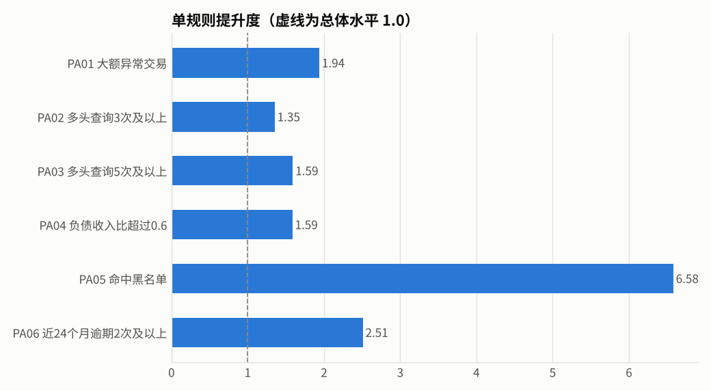
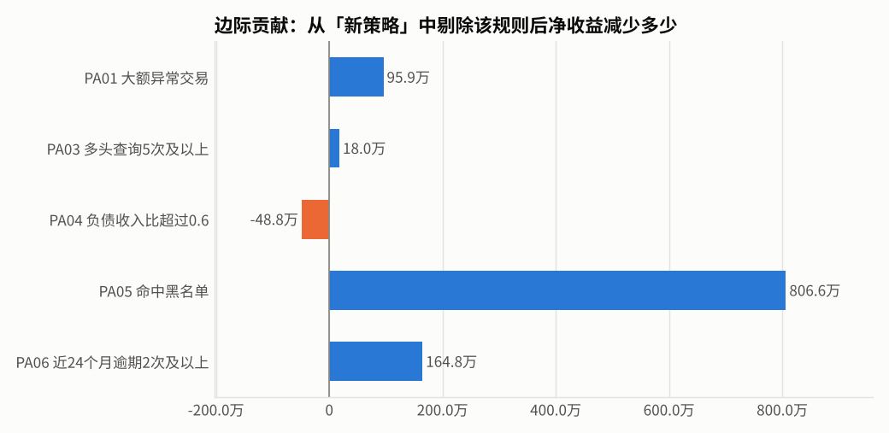
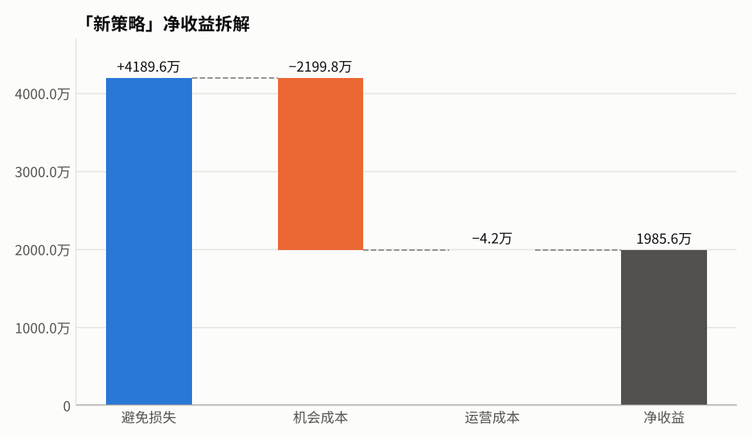
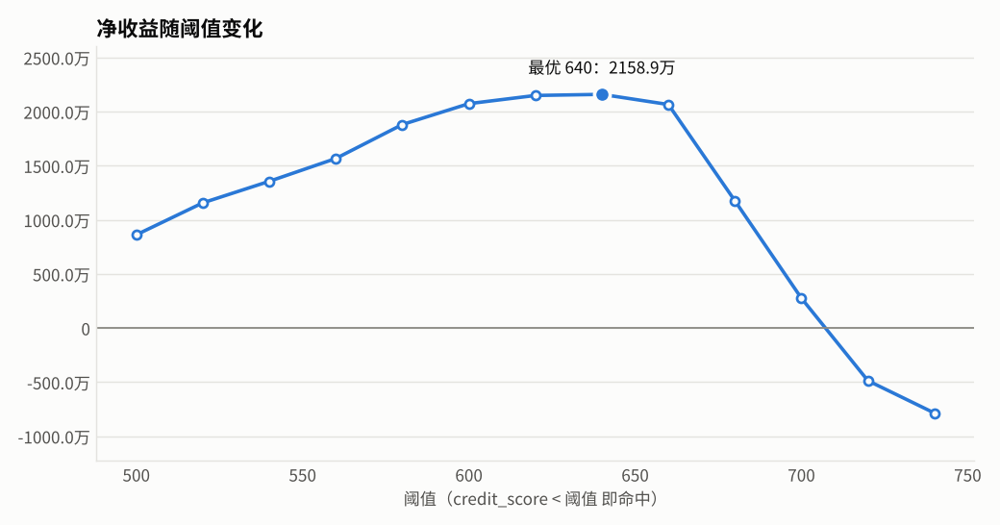
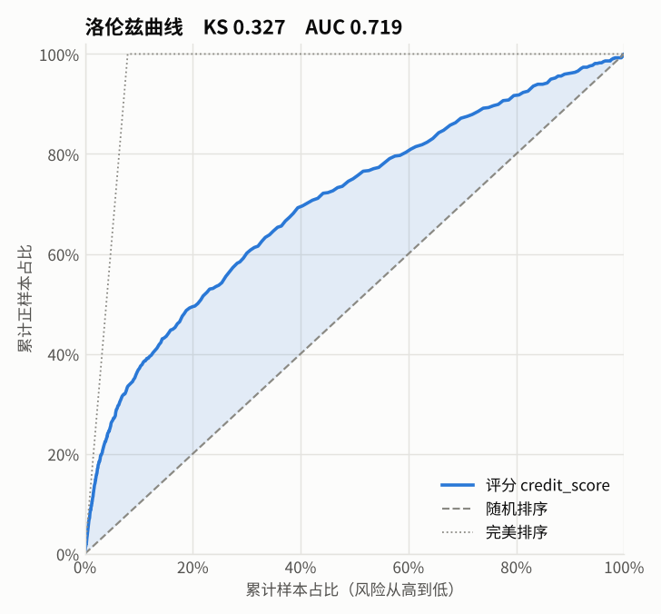
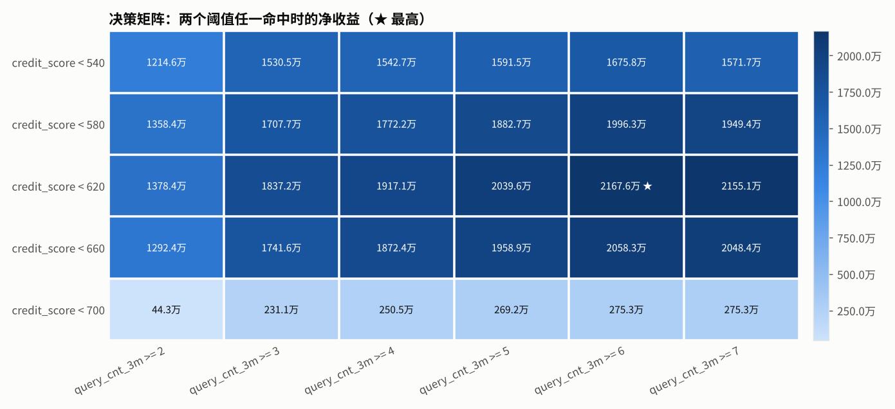

# 贷前审批：规则策略评估摘要

净收益 = 避免损失 − 机会成本 − 运营成本

## 结论

1. 样本 10,000 条，正样本 793 个，正样本率 7.93%。
2. 提升度最高的规则是 PA05 命中黑名单：命中 297 条，精确率 52.2%，提升度 6.58。
3. 新策略净收益 19,855,960 元，现行策略 8,932,171 元，新策略多 10,923,789 元；召回率 52.1% → 55.1%，精确率 10.8% → 15.5%，命中量 3832 → 2813。
4. 在新策略里，边际贡献最大的是 PA05 命中黑名单（8,065,515 元）。
5. 边际贡献为负的规则：PA04（-488,285），剔除后整体净收益反而更高，应收紧、合并或淘汰。
6. Swap 分析：新增命中的 426 条正样本率 27.5%，新增放行的 1445 条正样本率 6.4%（总体 7.93%）。
7. 阈值扫描：credit_score < 640 时净收益最高，为 21,589,189 元（命中 2679 条，召回率 56.4%）。
8. credit_score 的 KS 为 0.327，AUC 为 0.719。
9. 敏感性分析：避免损失与机会成本各浮动 30%，两套策略的优劣关系不变。
10. 稳定性：query_cnt_3m 在 2026-06 相对 2026-01 的 PSI 为 0.0011（稳定）。

## 单规则

| 规则ID | 规则名称 | 命中量 | 召回率 | 精确率 | 提升度 | 净收益 |
|---|---|---|---|---|---|---|
| PA01 | 大额异常交易 | 657 | 12.7% | 15.4% | 1.94 | 4,603,181 |
| PA02 | 多头查询3次及以上 | 2,803 | 38.0% | 10.7% | 1.35 | 6,113,717 |
| PA03 | 多头查询5次及以上 | 1,006 | 16.0% | 12.6% | 1.59 | 4,354,497 |
| PA04 | 负债收入比超过0.6 | 843 | 13.4% | 12.6% | 1.59 | 3,300,635 |
| PA05 | 命中黑名单 | 297 | 19.5% | 52.2% | 6.58 | 13,418,558 |
| PA06 | 近24个月逾期2次及以上 | 377 | 9.5% | 19.9% | 2.51 | 4,250,343 |

## 策略对比

| 策略 | 命中量 | 召回率 | 精确率 | 避免损失 | 机会成本 | 运营成本 | 净收益 |
|---|---|---|---|---|---|---|---|
| 现行策略 | 3,832 | 52.1% | 10.8% | 40,890,086 | 31,900,435 | 57,480 | 8,932,171 |
| 新策略 | 2,813 | 55.1% | 15.5% | 41,896,235 | 21,998,080 | 42,195 | 19,855,960 |
| 差异（新策略 − 现行策略） | -1,019 | 3.0% | 4.8% | 1,006,149 | -9,902,355 | -15,285 | 10,923,789 |

## 图表

### 单规则提升度

### 边际贡献

### 净收益瀑布图

### 阈值扫描净收益曲线

### 洛伦兹曲线

### 决策矩阵热力图

