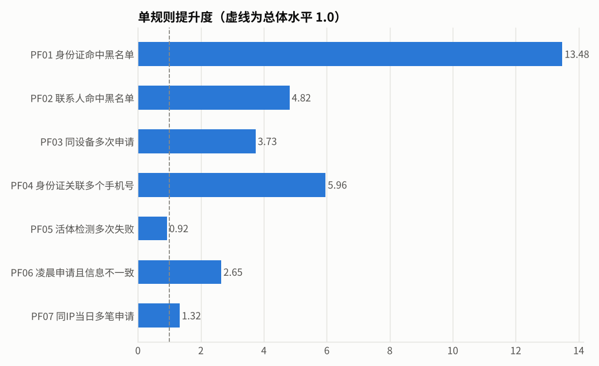
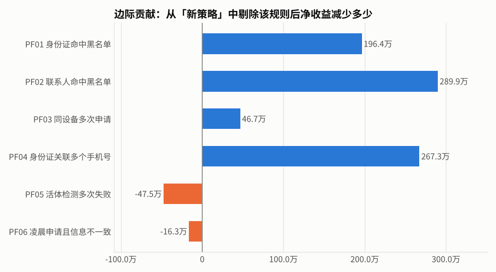
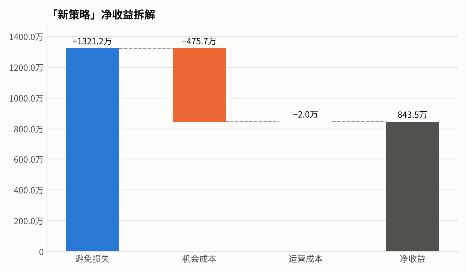
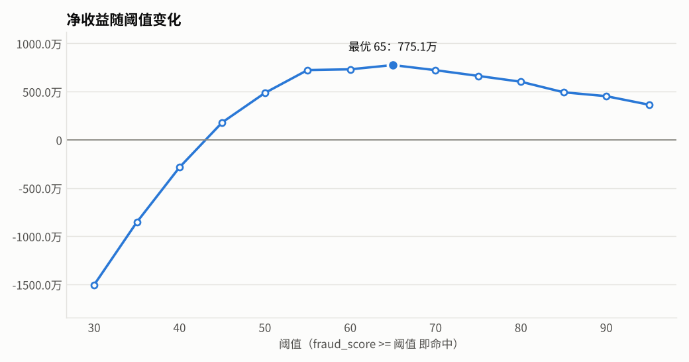
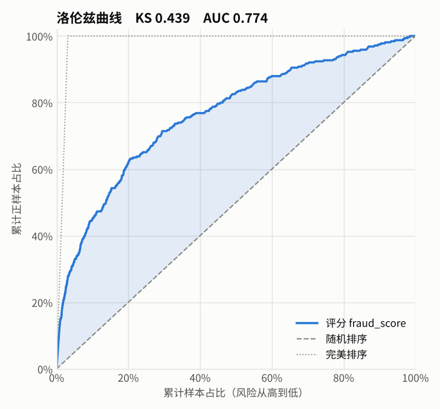
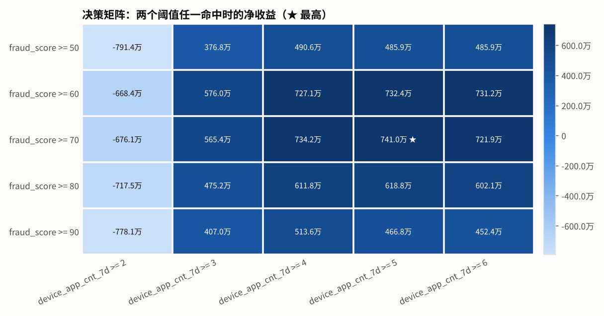

# 贷前反欺诈：规则策略评估摘要

净收益 = 避免损失 − 机会成本 − 运营成本

## 结论

1. 样本 10,000 条，正样本 315 个，正样本率 3.15%。
2. 提升度最高的规则是 PF01 身份证命中黑名单：命中 73 条，精确率 42.5%，提升度 13.48。
3. 提升度低于 1（命中群体的正样本率低于总体）的规则：PF05，需要检查阈值或逻辑。
4. 单独看净收益为负的规则：PF05、PF07。
5. 新策略净收益 8,435,021 元，现行策略 2,646,967 元，新策略多 5,788,054 元；召回率 22.2% → 47.0%，精确率 11.3% → 14.8%，命中量 621 → 997。
6. 在新策略里，边际贡献最大的是 PF02 联系人命中黑名单（2,899,487 元）。
7. 边际贡献为负的规则：PF05（-475,395）、PF06（-162,623），剔除后整体净收益反而更高，应收紧、合并或淘汰。
8. Swap 分析：新增命中的 681 条正样本率 12.5%，新增放行的 305 条正样本率 2.3%（总体 3.15%）。
9. 阈值扫描：fraud_score >= 65 时净收益最高，为 7,751,104 元（命中 986 条，召回率 44.8%）。
10. fraud_score 的 KS 为 0.439，AUC 为 0.774。
11. 敏感性分析：避免损失与机会成本各浮动 30%，两套策略的优劣关系不变。
12. 稳定性：fraud_score 在 2026-06 相对 2026-01 的 PSI 为 0.0169（稳定）。

## 单规则

| 规则ID | 规则名称 | 命中量 | 召回率 | 精确率 | 提升度 | 净收益 |
|---|---|---|---|---|---|---|
| PF01 | 身份证命中黑名单 | 73 | 9.8% | 42.5% | 13.48 | 2,315,371 |
| PF02 | 联系人命中黑名单 | 323 | 15.6% | 15.2% | 4.82 | 3,196,711 |
| PF03 | 同设备多次申请 | 221 | 8.3% | 11.8% | 3.73 | 1,085,071 |
| PF04 | 身份证关联多个手机号 | 261 | 15.6% | 18.8% | 5.96 | 3,218,704 |
| PF05 | 活体检测多次失败 | 103 | 1.0% | 2.9% | 0.92 | -241,418 |
| PF06 | 凌晨申请且信息不一致 | 48 | 1.3% | 8.3% | 2.65 | 67,360 |
| PF07 | 同IP当日多笔申请 | 336 | 4.4% | 4.2% | 1.32 | -760,985 |

## 策略对比

| 策略 | 命中量 | 召回率 | 精确率 | 避免损失 | 机会成本 | 运营成本 | 净收益 |
|---|---|---|---|---|---|---|---|
| 现行策略 | 621 | 22.2% | 11.3% | 5,716,620 | 3,057,233 | 12,420 | 2,646,967 |
| 新策略 | 997 | 47.0% | 14.8% | 13,211,910 | 4,756,949 | 19,940 | 8,435,021 |
| 差异（新策略 − 现行策略） | 376 | 24.8% | 3.6% | 7,495,290 | 1,699,716 | 7,520 | 5,788,054 |

## 图表

### 单规则提升度

### 边际贡献

### 净收益瀑布图

### 阈值扫描净收益曲线

### 洛伦兹曲线

### 决策矩阵热力图

